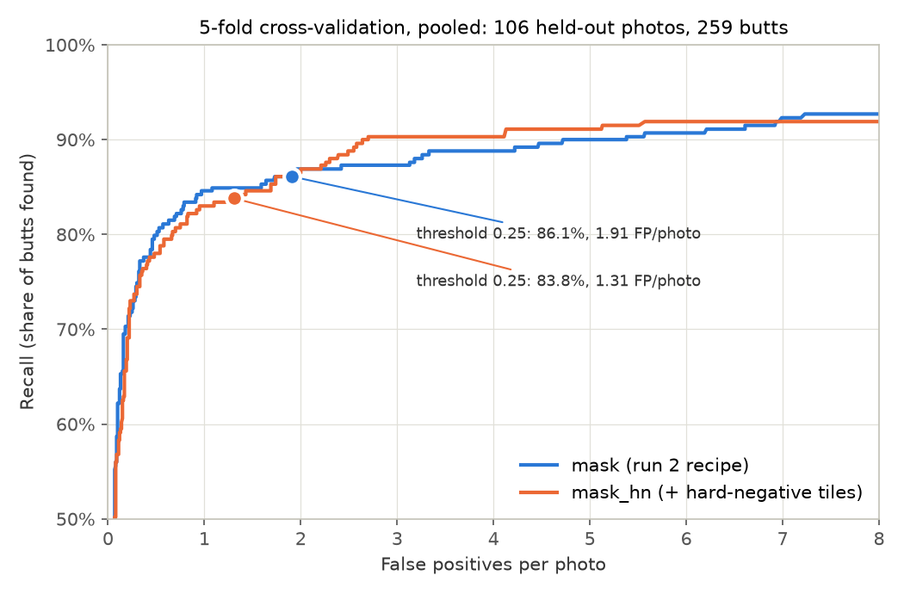

# litter-detection-pipeline

A pipeline for detecting small objects in high-resolution ground photos: annotate, split, export square tiles,
train an Ultralytics detector on Kaggle, and score any detector on whole frames with one evaluation harness.
It was built on cigarette butts on city pavement, photographed with a phone at about robot camera height.
This repository holds the code, the annotation tool with four example photos, the labelling policy and a capture
protocol. The full image set and its labels are a public Kaggle dataset (see Data).

## Results so far

Readable on a phone: [cross-validation results](https://lorinc.github.io/litter-detection-pipeline/docs/cross-validation.html)
and [first trained detectors against OWLv2](https://lorinc.github.io/litter-detection-pipeline/docs/training-runs.html).

All numbers come from one capture session (4000×1800 px phone photos), scored on whole photos by the evaluation
harness. Bracketed ranges are 95% intervals. The tables below use the validation split (19 photos, 46 labelled
butts, labelled without detector suggestions); the full write-up, with the recall-vs-false-positive curve, size
and shot-type tables and known gaps, is [`docs/training-runs.md`](docs/training-runs.md).

**Accuracy at each model's operating threshold**

| | Model | Threshold | Recall | False positives per photo |
|---|---|---|---|---|
| Baseline | OWLv2, zero-shot (`google/owlv2-base-patch16-ensemble`) | 0.10 | 97.8% (88.7–99.6%) | 7.3 (4.7–10.7) |
| Current, run 1 | YOLO11s trained here, uncertain (`maybe`) boxes as background | 0.25 | 82.6% (69.3–90.9%) | 1.6 (1.0–2.2) |
| Current, run 2 | YOLO11s trained here, uncertain (`maybe`) boxes masked | 0.25 | 89.1% (77.0–95.3%) | 2.4 (1.6–3.3) |

**Accuracy at matched recall** (false positives per photo at the lowest threshold that reaches the recall, read
from each model's curve; a fairer comparison than fixed thresholds)

| Recall at least | OWLv2 | Run 1 | Run 2 |
|---|---|---|---|
| 80% | 1.0 | 0.4 | 0.7 |
| 89% | 1.4 | 4.3 | 2.3 |
| 97.8% | 6.8 | not reached (maximum 89.1%) | 6.0 |

**Speed per photo** (50 tiles of 640 px for YOLO; 960 px tiles at 720 px spacing for OWLv2)

| Model | Parameters | Compute | Laptop CPU (i5-1145G7), measured | NVIDIA T4 GPU, estimated |
|---|---|---|---|---|
| OWLv2 (baseline) | 155 M | 11,488 GFLOPs | 119 s | about 6 s (within a factor of 2) |
| YOLO11s (current) | 9.4 M | 1,071 GFLOPs | 4.7–5.2 s | about 0.6–0.7 s |
| YOLO11n (projected, not trained yet) | 2.6 M | about 330 GFLOPs | not measured | about 0.2–0.5 s |

**Reading:**

- The trained YOLO11s is about 23 times faster than OWLv2 on the same CPU, from about 11 times less compute.
- Its accuracy is in OWLv2's range, not clearly better or worse: fewer false positives at 80% recall, more at
  89%, and slightly fewer at OWLv2's own recall. With 19 validation photos, most of these differences are inside
  the noise.
- Run 1 against run 2 (how uncertain boxes are treated in training) is inconclusive: their intervals overlap.
- The validation photos come from the same session as the training photos (same streets, light and phone), which
  flatters a trained model against a zero-shot one. A photo session at new locations is the real test.
- The T4 figures are estimates: YOLO11s from Ultralytics' own timing on a Kaggle T4 (12–15 ms per tile for the
  trained models, × 50 tiles), OWLv2 and YOLO11n scaled from it by compute. Small models use a GPU less
  efficiently, hence the wide YOLO11n range. No accuracy is projected for YOLO11n.
- Training YOLO11s for 100 epochs takes 22–24 minutes on one T4 with validation after every epoch, 11–14
  minutes without it (two runs sharing the machine).

**Cross-validation: hard-negative tiles** ([`docs/cross-validation.md`](docs/cross-validation.md))

Run 2's recipe (`mask`) against the same plus hard-negative tiles (`mask_hn`: one training tile centred on each
rejected zero-shot proposal). 5 folds over the 106 training and validation photos: fold 0 is the validation split,
folds 1–4 cut the training photos by time group, and their labels were made with zero-shot proposals on screen, so
pooled scores compare the two recipes with each other, not with OWLv2. Each recipe is trained once per fold and
scored on the fold it did not see (final-epoch checkpoint, threshold 0.25); pooled over all 106 photos (259 butts).
A difference counts as real when its 95% interval from a paired bootstrap over the same photos excludes zero.

| | Recall | False positives per photo |
|---|---|---|
| `mask` (run 2's recipe) | 86.1% (81.4–89.8%) | 1.91 (1.52–2.32) |
| `mask_hn` (+ hard-negative tiles) | 83.8% (78.8–87.8%) | 1.31 (1.01–1.63) |
| Difference | −2.3 points (−5.5 to +1.5), inside noise | −0.60 (−1.01 to −0.23), real |



- At threshold 0.25, hard-negative tiles cut false positives by about a third, lower in every fold, with the recall
  change inside noise.
- At equal recall (read from the pooled curves, no interval) the two are about the same between 75% and 86%
  recall: most of the cut comes from the hard-negative models scoring lower overall. `mask_hn` is ahead at 88–90%
  recall (2.3–2.6 against 3.2–4.7 false positives per photo).
- The switch adds both harder and many more butt-free tiles, so a gain would not say which caused it; a pair that
  changes only the share of empty tiles is next.

## The pipeline is parametric

Every setting lives in one JSON config (`pipeline/config.json`). Every script takes `--config PATH`, and paths in
the config are relative to the repository root. A new photo set, a different tile size, a different model or a
different training recipe is a new config file, not a code change.

| Config block | What it controls |
|---|---|
| `source_glob`, `data_dir`, `exclude` | Which photos are used, where derived data lives, photos left out of every step |
| `split` | Time-group split: minimum gap between photos in different splits, split fractions, seed, minimum counts per shot type and light |
| `detector`, `box_filter` | Zero-shot OWLv2 proposals for annotation (prompts, tiling, thresholds) and the optional box filter that ranks them |
| `annotate` | Annotation server (host, port, loupe sizes and zooms) |
| `downscale` | Recall per object size as photos are shrunk (factors, size bins, thresholds) |
| `export` | Training tiles: `downscale`, `tile`, `stride`, `min_visible` (share of a box that must be inside a tile), `maybe` (`background`, `butt`, `mask` or `drop_tile`), `background_share` (share of empty train tiles), `workers` |
| `train` | `model` (any Ultralytics weights name), pinned `ultralytics` version, `args` passed unchanged to Ultralytics' `train()` |
| `eval` | Harness settings (split, match rule, size bins, bootstrap) and one entry per detector, naming its adapter and threshold |
| `run` | Kaggle user and dataset, public repository, the scoring settings applied to each trained model |

**Switching the model.** Set `train.model`, e.g. `yolo11n.pt` for the nano size or `yolo11m.pt` for medium; any
Ultralytics YOLO weights name works, and the harness scores the result through its `yolo` adapter with no other
change. Training options (epochs, batch size, augmentation, caching) go into `train.args` unchanged. A different
model family needs one adapter class in `detectors.py` (`warmup`, `detect`, `info`) and an `eval.detectors` entry;
OWLv2 and YOLO are the two adapters so far.

**Runs and multiple GPUs.** `run.py NAME[=CONFIG] [NAME[=CONFIG] ...]` trains one or more runs in a single Kaggle
kernel; a bare `NAME` uses `pipeline/config.json`. Each run gets its own config, so one call can compare two models,
two export settings or two training recipes:

```
python run.py run1 run2=PATH/TO/maybe-mask.json   # run1: pipeline/config.json; run2: its own file
```

- The kernel checks the machine has at least as many GPUs as runs (Kaggle's T4 machine has two), clones this
  repository at the published commit, installs the pinned Ultralytics, exports each run's tiles, then trains all
  runs at once, each seeing only its own GPU. Kaggle's quota counts session time, so the second GPU is otherwise
  idle. Two runs in parallel take about 14% longer per epoch than one alone, because they share four CPU cores.
- Locally, `run.py` waits for the kernel, downloads the output, splits it per run and scores each trained model
  with the harness on whole validation photos.
- Each run writes `runs/NAME/`: the full config it used, `meta.json` (private and public commit, a hash of the
  labels, kernel, GPU), the kernel script, the training output and the harness result. The config alone
  reproduces the run; training caches tiles on disk, because Ultralytics warns that RAM caching can make training
  non-deterministic.
- Re-running the same command resumes: each step is skipped when its output exists.

**Scoring any detector the same way.** `evaluate.py NAME` runs the detector configured under `eval.detectors.NAME`
on whole photos (tiling, mapping boxes back and merging inside the adapter) and reports recall, false positives per
photo, the precision-recall and recall-vs-false-positive curves, recall per object size and shot type, time per
photo, parameters and FLOPs. Validation and test labels are drawn blind, without detector suggestions, so a model
trained on suggestion-assisted labels cannot hide the suggester's blind spots.

## Layout

- `pipeline/config.json`: every setting (see above).
- `annotation_tool/index.html`: the browser page of the annotation tool, served by `pipeline/annotate.py`.
- `annotation_tool/LABELING_POLICY.md`: the rule the annotation followed, and what it means for the labels.
- `annotation_tool/example/`: four example photos (landscape, JPEG, no metadata) with their own config; three are training photos with zero-shot proposals, one is a validation photo shown in blind mode. They vary in light (shade, sun, mixed), surface and shot type.
- `docs/training-runs.md`: the first trained detectors against the OWLv2 baseline.
- `docs/cross-validation.md`: 5-fold cross-validation of run 2's recipe against the same plus hard-negative tiles.
- `web_demo/`: a static page that runs the trained detector in the browser (see Web demo).
- `docs/capture-protocol.md`: how to shoot the next photo set, and which weakness of the current one each rule removes.

| Script | What it does |
|---|---|
| `preprocess.py` | Upright, metadata-free image copies, privacy blurring, `meta.csv` |
| `make_split.py` | Time-group train / val / test split |
| `propose.py`, `owl.py`, `train_filter.py` | Zero-shot OWLv2 proposals for annotation, with an optional box filter |
| `annotate.py` | Local annotation server (proposal mode for train images, blind mode for val and test) |
| `labels_util.py` | Label-record helpers |
| `downscale_detect.py`, `downscale_report.py` | Recall per object size as frames are shrunk |
| `perspective_check.py` | Ground-plane size check of detector boxes |
| `export.py` | Square tiles and YOLO labels from full frames and JSON labels |
| `train.py` | Ultralytics training on an export |
| `tiling.py`, `metrics.py`, `detectors.py`, `evaluate.py` | Evaluation harness: tiling, matching, detector adapters, full-frame scoring |
| `run.py`, `publish.py` | Sync code, train one or more runs on Kaggle (one GPU each), download, evaluate |
| `upload_kaggle.py` | Upload the image copies and labels as a Kaggle dataset (a new version if it exists) |

## Web demo

Live: <a href="https://lorinc.github.io/litter-detection-pipeline/web_demo/" target="_blank">https://lorinc.github.io/litter-detection-pipeline/web_demo/</a>

<a href="https://lorinc.github.io/litter-detection-pipeline/web_demo/" target="_blank"></a>

`web_demo/` runs a trained YOLO11s in the browser with ONNX Runtime Web: on the GPU through WebGPU where the
browser offers it, otherwise on the CPU. A selector offers two models: the hard-negative recipe's fold 0 model from
the cross-validation (default) and run 2, for comparison. Four validation photos run on a click, and visitors can try their
own photos, which are processed locally and never uploaded. An info panel states the photo the model is made for
(low camera height, full resolution, landscape, daylight, dry city pavement), that deviations lower accuracy, and
both models' measured accuracy.
The browser code ports the harness's tiling and merging exactly; the check is in `web_demo/README.md`. To run it
locally: `cd web_demo && python3 -m http.server 8765`, then open http://127.0.0.1:8765/.

## Trying the annotation tool

From `pipeline/`: `python annotate.py --config ../annotation_tool/example/config.json`, then open http://127.0.0.1:8712/. It needs only the Python standard library. Labels are saved to `annotation_tool/example/labels/`.

## Data

The complete dataset (125 street photos from one capture session in Valencia, Spain, on 2026-10-01, privacy-blurred and stripped of metadata, with hand-drawn labels and a frozen train / val / test split) is public on Kaggle as "Cigarette Litter Street Photo Dataset": https://www.kaggle.com/datasets/lorinc/butt-field-2026-10-01. Training runs mount it by its handle, `lorinc/butt-field-2026-10-01`. The dataset, including the example photos in
`annotation_tool/example/`, is licensed CC BY 4.0; the code is licensed AGPL-3.0.

## Running

Run scripts from `pipeline/`, e.g. `python export.py --data DATA_DIR --out EXPORT_DIR`. Training runs need a Kaggle
API token in `KAGGLE_API_TOKEN`. Dependencies: Python 3.12, torch, torchvision, transformers, ultralytics, pillow,
numpy, scikit-learn, matplotlib, kaggle, kagglehub.

## Licence

Code: AGPL-3.0 (see `LICENSE`). Photos and labels: CC BY 4.0 (see Data).
