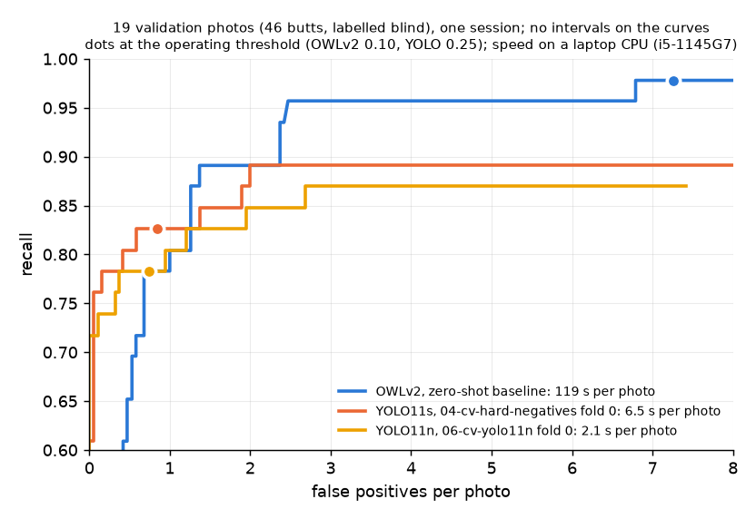
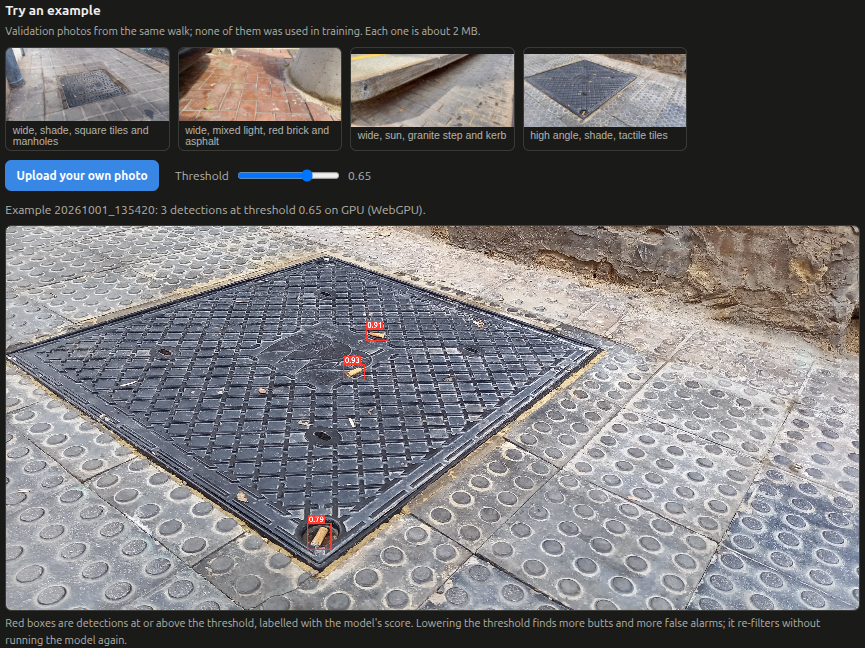

# litter-detection-pipeline

A pipeline for detecting small objects in high-resolution ground photos: annotate, split, export square tiles,
train an Ultralytics detector on Kaggle, and score any detector on whole frames with one evaluation harness.
It was built on cigarette butts on city pavement, photographed with a phone at about robot camera height.
This repository holds the code, the annotation tool with four example photos, the labelling policy and a capture
protocol. The full image set and its labels are a public Kaggle dataset (see Data).

## Results so far



The zero-shot baseline and the two current trained models on the same 19 validation photos (46 butts, labelled
without detector suggestions), scored on whole photos by one evaluation harness. The trained models are the fold 0
models of the cross-validation: they trained on the other 87 photos and never saw these 19. All photos come from
one capture session (4000×1800 px phone photos), one seed per model; bracketed ranges are 95% intervals, and the
curves have none.

| | OWLv2, zero-shot | YOLO11s (`04-cv-hard-negatives`, fold 0) | YOLO11n (`06-cv-yolo11n`, fold 0) |
|---|---|---|---|
| Operating threshold | 0.10 | 0.25 | 0.25 |
| Recall at that threshold | 97.8% (88.7–99.6%) | 82.6% (69.3–90.9%) | 78.3% (64.4–87.7%) |
| False positives per photo at that threshold | 7.3 (4.7–10.7) | 0.84 (0.47–1.32) | 0.74 (0.37–1.16) |
| False positives per photo at 70% recall | 0.58 | 0.05 | 0.00 |
| at 80% recall | 1.00 | 0.42 | 0.95 |
| at 85% recall | 1.26 | 1.89 | 2.68 |
| at 89% recall | 1.37 | 2.00 | not reached |
| at 97.8% recall | 6.79 | not reached | not reached |
| Highest recall reached | 100% | 89.1% | 87.0% |
| Parameters; compute per photo | 155 M; 11,488 GFLOPs | 9.4 M; 1,071 GFLOPs | 2.6 M; 322 GFLOPs |
| Time per photo, laptop CPU (i5-1145G7) | 119 s | 6.5 s | 2.1 s |
| Detection per 640 px tile, Kaggle T4 | not measured | 10.7 ms | 9.2 ms |

Matched-recall rows give false positives per photo at the highest threshold that reaches the recall, read from each
model's curve; they compare models at equal recall, which fixed thresholds do not. T4 figures are Ultralytics'
end-of-training timing on small batches and do not separate the two model sizes.

- **At strict settings (70–80% recall) both trained models match or beat OWLv2.**
- **From about 85% recall up, OWLv2 is more precise**, and the trained models cannot reach its high-recall range:
  they stop at 89.1% and 87.0% recall.
- **YOLO11n trades the high-recall end for speed:** about 3 times faster than YOLO11s on the same CPU and about 58
  times faster than OWLv2.
- **Every gap here rests on a few butts:** one butt is about 2 points of recall. The validation photos come from
  the same walk as the training photos, which flatters the trained models against a zero-shot one; a photo session
  at new locations is the real test.

**Cross-validation** (5 folds over all 106 training and validation photos, 263 butts; each recipe trained once per
fold and scored on the fold it did not see; threshold 0.25): `04-cv-hard-negatives` finds 84.0% (79.1–88.0%) with
1.26 (0.98–1.57) false positives per photo, `06-cv-yolo11n` 81.4% (76.2–85.6%) with 1.01 (0.77–1.22). Hard-negative
tiles cut false positives against run 02's recipe (`03-cv-baseline`) by 0.59 per photo at threshold 0.25, a real
cut by a paired bootstrap, but at matched recall (80%, 85%, 88%) no pair of recipes differs by more than noise.
YOLO11n is 2.5–3 times faster than YOLO11s on CPU across the runs and reaches at most 89.0% recall against 92.4%.
OWLv2 is not in the cross-validation, because training-photo labels were made with its proposals on screen.

Full write-ups, readable on a phone:
[trained detectors against OWLv2](https://lorinc.github.io/litter-detection-pipeline/docs/training-runs.html)
(this chart, runs `01-maybe-as-background` and `02-maybe-masked`, size and shot-type tables, known gaps) and
[cross-validation](https://lorinc.github.io/litter-detection-pipeline/docs/cross-validation.html)
(`03-cv-baseline` to `06-cv-yolo11n`, paired comparisons, matched recall, speed).

## The pipeline is parametric

Every setting lives in one JSON config (`pipeline/config.json`). Every script takes `--config PATH`, and paths in
the config are relative to the repository root. A new photo set, a different tile size, a different model or a
different training recipe is a new config file, not a code change.

| Config block | What it controls |
|---|---|
| `source_glob`, `data_dir`, `exclude` | Which photos are used, where derived data lives, photos left out of every step |
| `split` | Time-group split: minimum gap between photos in different splits, split fractions, seed, minimum counts per shot type and light |
| `detector`, `box_filter` | Zero-shot OWLv2 proposals for annotation (prompts, tiling, thresholds) and the optional box filter that ranks them |
| `annotate` | Annotation server (host, port, loupe sizes and zooms) |
| `downscale` | Recall per object size as photos are shrunk (factors, size bins, thresholds) |
| `export` | Training tiles: `downscale`, `tile`, `stride`, `min_visible` (share of a box that must be inside a tile), `maybe` (`background`, `butt`, `mask` or `drop_tile`), `background_share` (share of empty train tiles), `workers` |
| `train` | `model` (any Ultralytics weights name), pinned `ultralytics` version, `args` passed unchanged to Ultralytics' `train()` |
| `eval` | Harness settings (split, match rule, size bins, bootstrap) and one entry per detector, naming its adapter and threshold |
| `run` | Kaggle user and dataset, public repository, the scoring settings applied to each trained model |

**Switching the model.** Set `train.model`, e.g. `yolo11n.pt` for the nano size or `yolo11m.pt` for medium; any
Ultralytics YOLO weights name works, and the harness scores the result through its `yolo` adapter with no other
change. Training options (epochs, batch size, augmentation, caching) go into `train.args` unchanged. A different
model family needs one adapter class in `detectors.py` (`warmup`, `detect`, `info`) and an `eval.detectors` entry;
OWLv2 and YOLO are the two adapters so far.

**Runs and multiple GPUs.** `run.py NAME[=CONFIG] [NAME[=CONFIG] ...]` trains one or more runs in a single Kaggle
kernel; a bare `NAME` uses `pipeline/config.json`. Each run gets its own config, so one call can compare two models,
two export settings or two training recipes:

```
python run.py run1 run2=PATH/TO/maybe-mask.json   # run1: pipeline/config.json; run2: its own file
```

- The kernel checks the machine has at least as many GPUs as runs (Kaggle's T4 machine has two), clones this
  repository at the published commit, installs the pinned Ultralytics, exports each run's tiles, then trains all
  runs at once, each seeing only its own GPU. Kaggle's quota counts session time, so the second GPU is otherwise
  idle. Two runs in parallel take about 14% longer per epoch than one alone, because they share four CPU cores.
- Locally, `run.py` waits for the kernel, downloads the output, splits it per run and scores each trained model
  with the harness on whole validation photos.
- Each run writes `runs/NAME/`: the full config it used, `meta.json` (private and public commit, a hash of the
  labels, kernel, GPU), the kernel script, the training output and the harness result. The config alone
  reproduces the run; training caches tiles on disk, because Ultralytics warns that RAM caching can make training
  non-deterministic.
- Re-running the same command resumes: each step is skipped when its output exists.

**Scoring any detector the same way.** `evaluate.py NAME` runs the detector configured under `eval.detectors.NAME`
on whole photos (tiling, mapping boxes back and merging inside the adapter) and reports recall, false positives per
photo, the precision-recall and recall-vs-false-positive curves, recall per object size and shot type, time per
photo, parameters and FLOPs. Validation and test labels are drawn blind, without detector suggestions, so a model
trained on suggestion-assisted labels cannot hide the suggester's blind spots.

## Layout

- `pipeline/config.json`: every setting (see above).
- `annotation_tool/index.html`: the browser page of the annotation tool, served by `pipeline/annotate.py`.
- `annotation_tool/LABELING_POLICY.md`: the rule the annotation followed, and what it means for the labels.
- `annotation_tool/example/`: four example photos (landscape, JPEG, no metadata) with their own config; three are training photos with zero-shot proposals, one is a validation photo shown in blind mode. They vary in light (shade, sun, mixed), surface and shot type.
- `docs/training-runs.md`: the trained detectors against the OWLv2 baseline (the chart above, and the first runs `01-maybe-as-background` and `02-maybe-masked`).
- `docs/cross-validation.md`: 5-fold cross-validation of `03-cv-baseline`, `04-cv-hard-negatives`, `05-cv-more-empty-tiles` and `06-cv-yolo11n`.
- `web_demo/`: a static page that runs the trained detector in the browser (see Web demo).
- `docs/capture-protocol.md`: how to shoot the next photo set, and which weakness of the current one each rule removes.

| Script | What it does |
|---|---|
| `preprocess.py` | Upright, metadata-free image copies, privacy blurring, `meta.csv` |
| `make_split.py` | Time-group train / val / test split |
| `propose.py`, `owl.py`, `train_filter.py` | Zero-shot OWLv2 proposals for annotation, with an optional box filter |
| `annotate.py` | Local annotation server (proposal mode for train images, blind mode for val and test) |
| `labels_util.py` | Label-record helpers |
| `downscale_detect.py`, `downscale_report.py` | Recall per object size as frames are shrunk |
| `perspective_check.py` | Ground-plane size check of detector boxes |
| `export.py` | Square tiles and YOLO labels from full frames and JSON labels |
| `train.py` | Ultralytics training on an export |
| `tiling.py`, `metrics.py`, `detectors.py`, `evaluate.py` | Evaluation harness: tiling, matching, detector adapters, full-frame scoring |
| `run.py`, `publish.py` | Sync code, train one or more runs on Kaggle (one GPU each), download, evaluate |
| `upload_kaggle.py` | Upload the image copies and labels as a Kaggle dataset (a new version if it exists) |

## Web demo

Live: <a href="https://lorinc.github.io/litter-detection-pipeline/web_demo/" target="_blank">https://lorinc.github.io/litter-detection-pipeline/web_demo/</a>

<a href="https://lorinc.github.io/litter-detection-pipeline/web_demo/" target="_blank"></a>

`web_demo/` runs a trained YOLO11s in the browser with ONNX Runtime Web: on the GPU through WebGPU where the
browser offers it, otherwise on the CPU. A selector offers two models: "04 Hard negatives (fold 0)", the
`04-cv-hard-negatives` fold 0 model from the cross-validation (default), and "02 Maybe masked", run
`02-maybe-masked`, for comparison. Four validation photos run on a click, and visitors can try their
own photos, which are processed locally and never uploaded. An info panel states the photo the model is made for
(low camera height, full resolution, landscape, daylight, dry city pavement), that deviations lower accuracy, and
both models' measured accuracy.
The browser code ports the harness's tiling and merging exactly; the check is in `web_demo/README.md`. To run it
locally: `cd web_demo && python3 -m http.server 8765`, then open http://127.0.0.1:8765/.

## Trying the annotation tool

From `pipeline/`: `python annotate.py --config ../annotation_tool/example/config.json`, then open http://127.0.0.1:8712/. It needs only the Python standard library. Labels are saved to `annotation_tool/example/labels/`.

## Data

The complete dataset (125 street photos from one capture session in Valencia, Spain, on 2026-10-01, privacy-blurred and stripped of metadata, with hand-drawn labels and a frozen train / val / test split) is public on Kaggle as "Cigarette Litter Street Photo Dataset": https://www.kaggle.com/datasets/lorinc/butt-field-2026-10-01. Training runs mount it by its handle, `lorinc/butt-field-2026-10-01`. The dataset, including the example photos in
`annotation_tool/example/`, is licensed CC BY 4.0; the code is licensed AGPL-3.0.

## Running

Run scripts from `pipeline/`, e.g. `python export.py --data DATA_DIR --out EXPORT_DIR`. Training runs need a Kaggle
API token in `KAGGLE_API_TOKEN`. Dependencies: Python 3.12, torch, torchvision, transformers, ultralytics, pillow,
numpy, scikit-learn, matplotlib, kaggle, kagglehub.

## Licence

Code: AGPL-3.0 (see `LICENSE`). Photos and labels: CC BY 4.0 (see Data).
