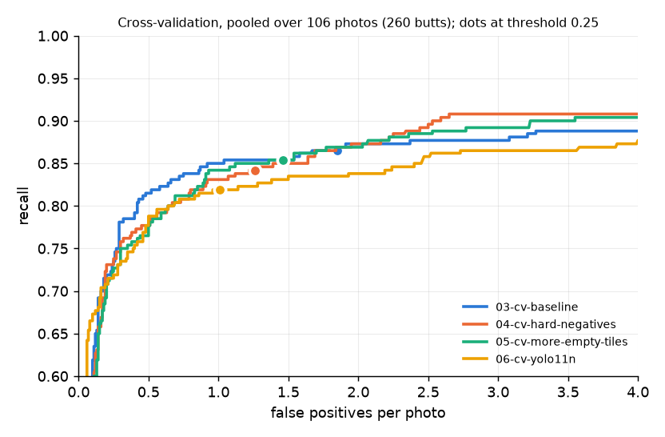

# Cross-validation: hard-negative tiles, butt-free tile share and model size

**Scope label:** YOLO11s and YOLO11n trained on one phone session (Valencia, Spain, 2026-10-01); 5-fold cross-validation over the 106 train and val photos (260 butts), one seed per fold; folds 1–4 carry proposal-assisted labels.

## Question

1. Do hard-negative tiles (training tiles centred on things that look like butts but are not) make the trained detector better, and is it their content or only their number that matters? The target is the false positives the trained model makes on wall cracks, gum spots and leaves.
2. What accuracy does the nano model (YOLO11n) cost against the small one (YOLO11s), for what speed?

## Setup

Runs are named `NN-what-it-tests`, numbered in the order they were made; `01` and `02` are in `training-runs.md`.

**Recipes** (full configs in `pipeline/recipes/`):

| | `03-cv-baseline` | `04-cv-hard-negatives` | `05-cv-more-empty-tiles` | `06-cv-yolo11n` |
|---|---|---|---|---|
| Tests | run 02's recipe under cross-validation, the reference for later runs | whether tiles centred on lookalikes cut false positives | whether 04's gain comes from the number of butt-free tiles alone | what accuracy the nano model costs against its speed |
| Model | YOLO11s, COCO-pretrained, Ultralytics 8.4.184 | same | same | YOLO11n, COCO-pretrained |
| `maybe` boxes | masked (painted flat grey) | same | same | same |
| Empty grid tiles | 10% of train tiles | 10% | 36% of train tiles, drawn at random from the grid | 10% |
| Hard-negative tiles | none | one 640 px tile per rejected OWLv2 proposal of the fold's train photos (proposals already fully inside an earlier such tile are skipped), on top of the empty tiles | none | as 04 |
| Training | Ultralytics defaults, 100 epochs, no per-epoch validation | same | same | same |

**Train tiles per fold** (from each run's `kaggle/export.json`; 06 uses 04's tiles):

| Fold | 03: tiles, butt-free | 04: tiles, butt-free | 05: tiles, butt-free |
|---|---|---|---|
| 0 | 466, 47 | 862, 340 | 655, 236 |
| 1 | 446, 45 | 710, 247 | 627, 226 |
| 2 | 422, 42 | 689, 243 | 594, 214 |
| 3 | 492, 49 | 850, 311 | 692, 249 |
| 4 | 517, 52 | 816, 266 | 727, 262 |

05 matches 04's share of butt-free tiles (33–39% across folds, 36% used for all folds), not their count: 04 has 4–104 more butt-free tiles per fold. 04 also trains on 21–25% more tiles with a butt (522 against 419 in fold 0), because some hard-negative tiles also hold a butt; 05 does not match that.

**Folds** (`data/folds.json`; butt counts from the current labels):

| Fold | Photos | Butts | What it is |
|---|---|---|---|
| 0 | 19 | 43 | the frozen val split, labelled blind (no detector suggestions) |
| 1 | 23 | 77 | train photos, cut by 14 s time groups |
| 2 | 21 | 72 | train photos |
| 3 | 24 | 40 | train photos; holds every train close-up (6) and so its model learns close-ups from fold 0's 3 only |
| 4 | 19 | 28 | train photos; holds most of the sunny photos |

- **Training and scoring:** each recipe is trained once per fold on the other four folds and scored on the fold it did not see. All 20 runs trained on Kaggle's T4 machine, two at a time: 03 and 04 from one kernel, 05 and 06 each from a kernel of their own at later commits with unchanged training code. The models trained on the labels before the review of the error analysis's suspect boxes, which added 4 butts and 1 `maybe` in folds 1–4 (`error-analysis.md`), and before the cigar-end rule (`annotation_tool/LABELING_POLICY.md`), which turned one cigarillo end seen in three fold 0 photos from `butt` into `maybe`; all scoring uses the current labels. The shared harness (`pipeline/evaluate.py`) scores the final-epoch checkpoint (`last.pt`) on whole photos at threshold 0.25: 640 px tiles, detections mapped back to the photo and merged, a butt found when a detection's centre falls inside its box or they overlap by at least 30%, `maybe` boxes counting neither way.
- **Pooled:** every one of the 106 photos is held out exactly once, so the pooled score is all 106 photos (260 butts), each scored by the model that did not train on it (`pipeline/cv_report.py`). The pooled curve applies one threshold to all five models of a recipe.
- **Paired comparison:** a bootstrap of 1,000 resamples of the same photos, scoring both recipes on each resample. A difference counts as real only when its 95% interval excludes zero.
- **Matched recall:** a fixed threshold rewards any recipe that lowers its scores, so recipes are also compared at fixed recall: false positives per photo at the highest threshold whose pooled recall reaches the level (80%, 85%, 88%). The paired interval re-finds each recipe's threshold on every resample, on the same 1,000 resamples as the paired test. A resample in which a recipe never reaches the level is left out and counted.
- **Labels:** folds 1–4 carry train labels, made with OWLv2's proposals on screen. Pooled scores therefore compare recipes with each other, not with OWLv2; the comparison with OWLv2 stays on fold 0.
- **Records:** `runs/cv_<recipe>.json` per recipe, `runs/cv_<A>_vs_<B>.json` and `.log` per pair, and per run `runs/<recipe>_f<k>/` (config, commits, training output, harness result). Chart: `pipeline/cv_plot.py`.

## Results

**Pooled, at threshold 0.25** (95% intervals: Wilson for recall, a bootstrap over whole photos for false positives):

| | Recall | False positives per photo | Boxes per photo | Precision |
|---|---|---|---|---|
| 03 baseline | 86.5% (81.9–90.2%), 225 of 260 | 1.85 (1.45–2.25) | 4.46 | 0.56 |
| 04 hard negatives | 84.2% (79.3–88.2%), 219 of 260 | 1.26 (0.98–1.57) | 3.74 | 0.64 |
| 05 more empty tiles | 85.4% (80.6–89.2%), 222 of 260 | 1.46 (1.18–1.75) | 3.96 | 0.61 |
| 06 YOLO11n | 81.9% (76.8–86.1%), 213 of 260 | 1.01 (0.77–1.22) | 3.39 | 0.69 |

**Paired differences** (95% interval):

| | Recall | False positives per photo |
|---|---|---|
| 04 − 03 | −2.3 points (−5.6 to +1.5): inside noise | −0.59 (−1.01 to −0.22): real |
| 05 − 03 | −1.1 points (−4.0 to +1.6): inside noise | −0.39 (−0.71 to −0.10): real |
| 04 − 05 | −1.2 points (−4.0 to +1.8): inside noise | −0.20 (−0.43 to +0.06): inside noise |
| 06 − 04 | −2.3 points (−6.4 to +0.9): inside noise | −0.25 (−0.50 to −0.03): real |

**Per fold, at threshold 0.25** (butts found; false positives per photo):

| Fold | Butts | 03 found | 04 found | 05 found | 06 found | 03 FP | 04 FP | 05 FP | 06 FP |
|---|---|---|---|---|---|---|---|---|---|
| 0 (val, blind) | 43 | 36 | 36 | 37 | 35 | 1.58 | 0.84 | 1.58 | 0.74 |
| 1 | 77 | 61 | 54 | 60 | 57 | 2.17 | 1.57 | 2.17 | 1.30 |
| 2 | 72 | 62 | 62 | 59 | 59 | 2.81 | 1.90 | 1.48 | 0.95 |
| 3 (close-ups) | 40 | 39 | 40 | 38 | 38 | 1.62 | 1.21 | 1.17 | 1.21 |
| 4 (sun) | 28 | 27 | 27 | 28 | 24 | 0.95 | 0.68 | 0.84 | 0.74 |

04 has fewer false positives than 03 in every fold. 05 equals 03 in folds 0 and 1 and is below 04 in folds 2 and 3. 06 has fewer false positives than 04 in four folds and finds fewer butts in four.

**At matched recall** (false positives per photo at the highest threshold whose pooled recall reaches the level, with that threshold; 95% interval from the bootstrap, threshold re-found on every resample; `runs/cv_<A>_vs_<B>.log`):

| Recall at least | 03 | 04 | 05 | 06 |
|---|---|---|---|---|
| 80% | 0.42 (0.21–0.95), threshold 0.70 | 0.64 (0.24–1.50), threshold 0.50 | 0.64 (0.29–1.09), threshold 0.51 | 0.64 (0.29–2.44), threshold 0.38 |
| 85% | 0.92 (0.36–4.14), threshold 0.45 | 1.39 (0.58–2.60), threshold 0.21 | 1.12 (0.62–2.91), threshold 0.32 | 2.40 (0.56–5.98), threshold 0.10 |
| 88% | 3.08 (0.59–6.92), threshold 0.13 | 2.22 (0.83–4.76), threshold 0.10 | 2.22 (0.82–8.13), threshold 0.15 | 4.25 (1.21–8.03), threshold 0.04 |

**Paired differences at matched recall** (false positives per photo, 95% interval; `runs/cv_<A>_vs_<B>.json`):

| Recall at least | 04 − 03 | 05 − 03 | 04 − 05 | 06 − 04 |
|---|---|---|---|---|
| 80% | +0.23 (−0.13 to +0.76) | +0.23 (−0.10 to +0.54) | 0.00 (−0.30 to +0.60) | 0.00 (−0.33 to +1.31) |
| 85% | +0.46 (−1.88 to +1.12) | +0.20 (−1.62 to +1.18) | +0.26 (−0.87 to +0.89) | +1.01 (−0.33 to +3.83) |
| 88% | −0.86 (−4.27 to +1.09) | −0.86 (−3.52 to +2.84) | 0.00 (−4.74 to +1.23) | +2.03 (−0.12 to +5.48) |

Every interval includes zero. 06 never reaches 85% recall in 37 of the 1,000 resamples and 88% in 281; 04 never reaches 88% in 13 (14 in the 04 − 05 pair); 05 never reaches 88% in 1. Those resamples are left out.

The highest recall each recipe reaches, at the lowest threshold kept (0.01), is 93.8% (03), 92.7% (04), 93.8% (05) and 89.2% (06).

**Recall by butt size** (box long side, native px; pooled, threshold 0.25; no butt is under 20 px):

| Size | Butts | 03 | 04 | 05 | 06 |
|---|---|---|---|---|---|
| 20–30 px | 2 | 0 | 0 | 0 | 0 |
| 30–45 px | 34 | 27 (79%) | 24 (71%) | 24 (71%) | 22 (65%) |
| 45–60 px | 55 | 45 (82%) | 44 (80%) | 44 (80%) | 43 (78%) |
| 60–90 px | 74 | 62 (84%) | 63 (85%) | 63 (85%) | 61 (82%) |
| 90–120 px | 53 | 52 (98%) | 49 (92%) | 52 (98%) | 50 (94%) |
| 120 px and up | 42 | 39 (93%) | 39 (93%) | 39 (93%) | 37 (88%) |

**By shot type** (pooled, threshold 0.25; recall with found butts, false positives per photo):

| Shot type | Photos | Butts | 03 | 04 | 05 | 06 |
|---|---|---|---|---|---|---|
| Wide | 92 | 230 | 86% (198), 1.82 | 83% (191), 1.28 | 84% (194), 1.46 | 80% (185), 1.01 |
| Close-up | 9 | 19 | 89% (17), 2.33 | 95% (18), 1.11 | 95% (18), 1.67 | 95% (18), 1.22 |
| High | 5 | 11 | 91% (10), 1.60 | 91% (10), 1.20 | 91% (10), 1.20 | 91% (10), 0.60 |

**Fold 0 against run 02.** Fold 0's models train on the same 87 photos as `02-maybe-masked`, and 03 is 02's recipe; the val labels are identical (same label hash in all harness results).

| | Checkpoint scored | Recall | False positives per photo | Source |
|---|---|---|---|---|
| 02 maybe masked | `best.pt` | 90.7% (39 of 43) | 2.37 | `runs/02-maybe-masked/02-maybe-masked_val.json` |
| 03 baseline, fold 0 | `last.pt` | 83.7% (36 of 43) | 1.58 | `runs/03-cv-baseline_f0/03-cv-baseline_f0_val.json` |
| 04 hard negatives, fold 0 | `last.pt` | 83.7% (36 of 43) | 0.84 | `runs/04-cv-hard-negatives_f0/04-cv-hard-negatives_f0_val.json` |
| 05 more empty tiles, fold 0 | `last.pt` | 86.0% (37 of 43) | 1.58 | `runs/05-cv-more-empty-tiles_f0/05-cv-more-empty-tiles_f0_val.json` |
| 06 YOLO11n, fold 0 | `last.pt` | 81.4% (35 of 43) | 0.74 | `runs/06-cv-yolo11n_f0/06-cv-yolo11n_f0_val.json` |

02 and 03 fold 0 differ in two ways besides training randomness: 02 kept the checkpoint with the best tile-level score on these same val photos (`best.pt`), which flatters it on val, and it validated after every epoch. The 3-butt gap is inside both runs' recall intervals (70.0–91.9% and 78.4–96.3%), so it does not separate checkpoint choice from training noise.

**Speed and size:**

| | Parameters | Compute per photo (50 tiles) | Harness time per photo, this PC's CPU |
|---|---|---|---|
| YOLO11s (03, 04, 05) | 9.4 M | 1,071 GFLOPs | 4.7–7.9 s across the 15 runs; 6.5–6.8 s for the 04 runs |
| YOLO11n (06) | 2.6 M | 322 GFLOPs | 2.1–2.8 s across the 5 runs |

On the same PC, the nano model scores a photo about 2.5–3 times faster than the 04 runs (`<run>_val.json`, `speed`), from about 3.3 times less compute. Ultralytics' end-of-training timing on the T4 (`kaggle/train.log`) gives 8.0–14.5 ms of detection per tile for YOLO11n against 10.7 ms for 04 fold 0, so it does not separate the two sizes; it is taken on small validation batches.

**Training time:** 100 epochs took 11–14 min per 03 run (0.191–0.225 h), 17–21 min per 04 run (0.283–0.350 h), 15–17 min per 05 run (0.252–0.290 h) and 11–18 min per 06 run (0.184–0.304 h), with two runs sharing the machine. The 03 and 04 kernel, 10 runs in 5 rounds, ran 99 min (`runs/03-cv-baseline_f0/kaggle/butt-train-mask-mask-hn-cv.log`; Kaggle kernel names keep the names the runs had when trained); the 06 kernel, 5 runs in 3 rounds, ran 56 min.

## Reading

- **At the fixed threshold 0.25, hard-negative tiles cut false positives by 0.6 per photo (about a third), and the recall change is inside noise.** The cut is real by the paired test and shows in every fold, including the blind fold 0.
- **Random butt-free tiles in the same share cut false positives by 0.4 per photo, also real; the hard-negative tiles' further 0.2 is inside noise.** On this data, about two thirds of the hard-negative gain at 0.25 is matched by more butt-free tiles of any kind, and the remaining third is not distinguishable from zero. This does not show that the tiles' content adds nothing: the interval reaches −0.43, the gain is concentrated in folds 0 and 1 where 05 does nothing, and 04 has more butt-free tiles and more butt tiles than 05.
- **At matched recall, no pair of recipes differs by more than noise at 80%, 85% or 88%.** The fixed-threshold cuts of 04 and 05 against 03 are therefore not shown at equal recall: most of them comes from 04 and 05 giving lower scores overall, so the threshold 0.25 sits at a lower recall on a similar curve.
- **The matched-recall intervals are wide** (up to 5 false positives per photo at 88%), because the curves are steep there: a few butts more or less in a resample move the threshold across many false positives. At this data size, matched recall cannot resolve differences of the size seen at threshold 0.25.
- **YOLO11n is 2.5–3 times faster on CPU and gives up the high-recall end.** At 0.25 it has fewer false positives (real, −0.25) and 2.3 points less recall (inside noise), the same pattern of lower scores as above. At 80% recall it equals 04. Above that it falls behind: it reaches at most 89.2% recall against 92.7%, at 85% it has 1.01 more false positives per photo and at 88% 2.03 more, with intervals that include zero only narrowly at 88% (−0.12 to +5.48) and that leave out the 28% of resamples in which it never gets there. It loses most on the largest butts (120 px and up: 37 against 39 of 42) and on small ones (30–45 px: 22 against 24 of 34).
- **Where recall moves:** 04 loses 7 butts in fold 1 and 04 and 05 lose a few small butts (30–45 px: 24 against 27 of 34). Each of these rests on a handful of butts and is inside the intervals.
- **What this does not show:** whether the hard-negative content helps beyond tile count at a level this data can resolve; how any recipe does on new streets (all photos come from one 22-minute walk); how much of any difference is training randomness (one seed per fold); speed on any robot hardware.

## Known gaps

- One seed per fold. The paired bootstrap resamples photos with the trained models held fixed, so training-to-training variation is not in any interval.
- Matched-recall intervals leave out the resamples in which a recipe never reaches the level (up to 281 of 1,000 for 06 at 88%), which narrows them; values at 90% and above are read off the curves without an interval.
- The pooled curve applies one threshold to five separately trained models whose scores need not be on the same scale.
- Folds 1–4 carry labels made with OWLv2's proposals on screen; only fold 0's 43 butts are labelled blind. The models trained before 4 butts and 1 `maybe` were added in review and before the cigar-end rule, so the models of folds 1–4 trained with one cigarillo end labelled `butt` in three fold 0 photos; scoring uses the current labels.
- Fold 3 holds every train close-up and fold 4 most of the sun, so per-fold differences mix recipe with condition.
- 05 matches 04's share of butt-free tiles, not their count, and not the extra butt tiles that hard-negative tiles bring.
- 05 and 06 trained in separate kernels from 03 and 04; training code and data are the same, GPU nondeterminism is not controlled.
- YOLO11n keeps every setting of 04, including batch size; no setting was tuned for the smaller model.
- CPU timing is this PC's, with other work running at times; no robot hardware has been timed.
- All photos come from one session; no held-out session exists.
- No butt is under 20 px and only 2 are under 30 px, so nothing here measures the trained model's size floor.
- The test split has not been scored; it is reserved for the finalist.
