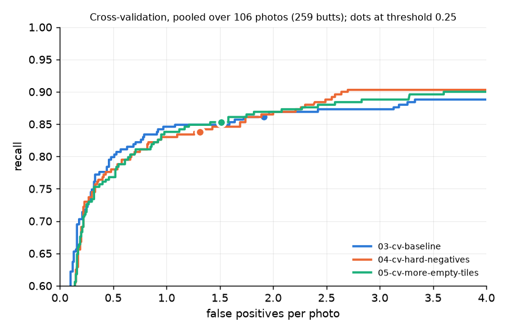

# Cross-validation: hard-negative tiles and butt-free tile share

**Scope label:** YOLO11s trained on one phone session (Valencia, Spain, 2026-10-01); 5-fold cross-validation over the 106 train and val photos (259 butts), one seed per fold; folds 1–4 carry proposal-assisted labels.

## Question

Do hard-negative tiles (training tiles centred on things that look like butts but are not) make the trained detector better, and is it their content or only their number that matters? The target is the false positives the trained model makes on wall cracks, gum spots and leaves.

## Setup

Runs are named `NN-what-it-tests`, numbered in the order they were made; `01` and `02` are in `training-runs.md`.

**Recipes** (full configs in `pipeline/recipes/`):

| | `03-cv-baseline` | `04-cv-hard-negatives` | `05-cv-more-empty-tiles` |
|---|---|---|---|
| Tests | run 02's recipe under cross-validation, the reference for later runs | whether tiles centred on lookalikes cut false positives | whether 04's gain comes from the number of butt-free tiles alone |
| Model | YOLO11s, COCO-pretrained, Ultralytics 8.4.184 | same | same |
| `maybe` boxes | masked (painted flat grey) | same | same |
| Empty grid tiles | 10% of train tiles | 10% | 36% of train tiles, drawn at random from the grid |
| Hard-negative tiles | none | one 640 px tile per rejected OWLv2 proposal of the fold's train photos (proposals already fully inside an earlier such tile are skipped), on top of the empty tiles | none |
| Training | Ultralytics defaults, 100 epochs, no per-epoch validation | same | same |

**Train tiles per fold** (from each run's `kaggle/export.json`):

| Fold | 03: tiles, butt-free | 04: tiles, butt-free | 05: tiles, butt-free |
|---|---|---|---|
| 0 | 466, 47 | 862, 340 | 655, 236 |
| 1 | 446, 45 | 710, 247 | 627, 226 |
| 2 | 422, 42 | 689, 243 | 594, 214 |
| 3 | 492, 49 | 850, 311 | 692, 249 |
| 4 | 517, 52 | 816, 266 | 727, 262 |

05 matches 04's share of butt-free tiles (33–39% across folds, 36% used for all folds), not their count: 04 has 4–104 more butt-free tiles per fold. 04 also trains on 21–25% more tiles with a butt (522 against 419 in fold 0), because some hard-negative tiles also hold a butt; 05 does not match that.

**Folds** (`data/folds.json`):

| Fold | Photos | Butts | What it is |
|---|---|---|---|
| 0 | 19 | 46 | the frozen val split, labelled blind (no detector suggestions) |
| 1 | 23 | 76 | train photos, cut by 14 s time groups |
| 2 | 21 | 71 | train photos |
| 3 | 24 | 38 | train photos; holds every train close-up (6) and so its model learns close-ups from fold 0's 3 only |
| 4 | 19 | 28 | train photos; holds most of the sunny photos |

- **Training and scoring:** each recipe is trained once per fold on the other four folds and scored on the fold it did not see. All 15 runs trained on Kaggle's T4 machine, two at a time: 03 and 04 from one kernel, 05 from a second kernel at a later commit with unchanged training code. The shared harness (`pipeline/evaluate.py`) scores the final-epoch checkpoint (`last.pt`) on whole photos at threshold 0.25: 640 px tiles, detections mapped back to the photo and merged, a butt found when a detection's centre falls inside its box or they overlap by at least 30%, `maybe` boxes counting neither way.
- **Pooled:** every one of the 106 photos is held out exactly once, so the pooled score is all 106 photos (259 butts), each scored by the model that did not train on it (`pipeline/cv_report.py`). The pooled curve applies one threshold to all five models of a recipe.
- **Paired comparison:** a bootstrap of 1,000 resamples of the same photos, scoring both recipes on each resample. A difference counts as real only when its 95% interval excludes zero.
- **Labels:** folds 1–4 carry train labels, made with OWLv2's proposals on screen. Pooled scores therefore compare recipes with each other, not with OWLv2; the comparison with OWLv2 stays on fold 0.
- **Records:** `runs/cv_<recipe>.json` per recipe, `runs/cv_<A>_vs_<B>.json` and `.log` per pair, and per run `runs/<recipe>_f<k>/` (config, commits, training output, harness result). Chart: `pipeline/cv_plot.py`.

## Results

**Pooled, at threshold 0.25** (95% intervals: Wilson for recall, a bootstrap over whole photos for false positives):

| | Recall | False positives per photo | Boxes per photo | Precision |
|---|---|---|---|---|
| 03 baseline | 86.1% (81.4–89.8%), 223 of 259 | 1.91 (1.52–2.32) | 4.46 | 0.56 |
| 04 hard negatives | 83.8% (78.8–87.8%), 217 of 259 | 1.31 (1.01–1.63) | 3.74 | 0.63 |
| 05 more empty tiles | 85.3% (80.5–89.1%), 221 of 259 | 1.51 (1.22–1.81) | 3.96 | 0.60 |

**Paired differences** (95% interval):

| | Recall | False positives per photo |
|---|---|---|
| 04 − 03 | −2.3 points (−5.5 to +1.5): inside noise | −0.60 (−1.01 to −0.23): real |
| 05 − 03 | −0.8 points (−3.3 to +2.1): inside noise | −0.40 (−0.72 to −0.10): real |
| 04 − 05 | −1.5 points (−4.3 to +1.3): inside noise | −0.20 (−0.43 to +0.05): inside noise |

**Per fold, at threshold 0.25** (recall as found of butts; false positives per photo):

| Fold | Butts | 03 found | 04 found | 05 found | 03 FP | 04 FP | 05 FP |
|---|---|---|---|---|---|---|---|
| 0 (val, blind) | 46 | 38 | 38 | 39 | 1.58 | 0.84 | 1.58 |
| 1 | 76 | 60 | 53 | 59 | 2.22 | 1.61 | 2.22 |
| 2 | 71 | 61 | 61 | 58 | 2.95 | 2.00 | 1.62 |
| 3 (close-ups) | 38 | 37 | 38 | 37 | 1.71 | 1.29 | 1.21 |
| 4 (sun) | 28 | 27 | 27 | 28 | 0.95 | 0.68 | 0.84 |

04 has fewer false positives than 03 in every fold. 05 equals 03 in folds 0 and 1 and is below 04 in folds 2 and 3.

**At matched recall** (false positives per photo at the highest threshold whose pooled recall reaches the level; read from the pooled curves, no interval):

| Recall at least | 03 | 04 | 05 |
|---|---|---|---|
| 75% | 0.32 | 0.33 | 0.32 |
| 80% | 0.51 | 0.67 | 0.66 |
| 83.8% (04 at 0.25) | 0.91 (threshold 0.48) | 1.26 (threshold 0.26) | 0.98 (threshold 0.36) |
| 86.1% (03 at 0.25) | 1.73 (threshold 0.28) | 1.74 (threshold 0.17) | 1.58 (threshold 0.24) |
| 88% | 3.18 | 2.30 | 2.42 |
| 90% | 4.72 | 2.64 | 3.60 |
| 92% | 6.99 | 8.42 | 9.25 |

The highest recall each recipe reaches, at the lowest threshold kept (0.01), is 93.8% (03), 92.3% (04) and 93.4% (05).

**Recall by butt size** (box long side, native px; pooled, threshold 0.25; no butt is under 20 px):

| Size | Butts | 03 | 04 | 05 |
|---|---|---|---|---|
| 20–30 px | 2 | 0 | 0 | 0 |
| 30–45 px | 30 | 23 (77%) | 20 (67%) | 21 (70%) |
| 45–60 px | 55 | 45 (82%) | 44 (80%) | 44 (80%) |
| 60–90 px | 74 | 62 (84%) | 63 (85%) | 63 (85%) |
| 90–120 px | 53 | 52 (98%) | 49 (92%) | 52 (98%) |
| 120 px and up | 45 | 41 (91%) | 41 (91%) | 41 (91%) |

**By shot type** (pooled, threshold 0.25; recall with found butts, false positives per photo):

| Shot type | Photos | Butts | 03 | 04 | 05 |
|---|---|---|---|---|---|
| Wide | 92 | 228 | 86% (196), 1.88 | 83% (189), 1.34 | 85% (193), 1.51 |
| Close-up | 9 | 20 | 85% (17), 2.33 | 90% (18), 1.11 | 90% (18), 1.67 |
| High | 5 | 11 | 91% (10), 1.60 | 91% (10), 1.20 | 91% (10), 1.20 |

**Fold 0 against run 02.** Fold 0's models train on the same 87 photos as `02-maybe-masked`, and 03 is 02's recipe; the val labels are identical (same label hash in all harness results).

| | Checkpoint scored | Recall | False positives per photo | Source |
|---|---|---|---|---|
| 02 maybe masked | `best.pt` | 89.1% (41 of 46) | 2.37 | `runs/02-maybe-masked/02-maybe-masked_val.json` |
| 03 baseline, fold 0 | `last.pt` | 82.6% (38 of 46) | 1.58 | `runs/03-cv-baseline_f0/03-cv-baseline_f0_val.json` |
| 04 hard negatives, fold 0 | `last.pt` | 82.6% (38 of 46) | 0.84 | `runs/04-cv-hard-negatives_f0/04-cv-hard-negatives_f0_val.json` |
| 05 more empty tiles, fold 0 | `last.pt` | 84.8% (39 of 46) | 1.58 | `runs/05-cv-more-empty-tiles_f0/05-cv-more-empty-tiles_f0_val.json` |

02 and 03 fold 0 differ in two ways besides training randomness: 02 kept the checkpoint with the best tile-level score on these same val photos (`best.pt`), which flatters it on val, and it validated after every epoch. The 3-butt gap is inside both runs' recall intervals (69.3–90.9% and 77.0–95.3%), so it does not separate checkpoint choice from training noise.

**Training time:** 100 epochs took 11–14 min per 03 run (0.191–0.225 h), 17–21 min per 04 run (0.283–0.350 h) and 15–17 min per 05 run (0.252–0.290 h), with two runs sharing the machine. The 03 and 04 kernel, 10 runs in 5 rounds, ran 99 min (`runs/03-cv-baseline_f0/kaggle/butt-train-mask-mask-hn-cv.log`; Kaggle kernel names keep the names the runs had when trained). All three recipes are the same YOLO11s, so detection cost per photo is the same (9.4 M parameters, 1,071 GFLOPs); the harness timed 4.7–7.9 s per photo on this PC's CPU across the 15 runs, a spread not caused by the recipe.

## Reading

- **At the fixed threshold 0.25, hard-negative tiles cut false positives by 0.6 per photo (about a third), and the recall change is inside noise.** The cut is real by the paired test and shows in every fold, including the blind fold 0.
- **Random butt-free tiles in the same share cut false positives by 0.4 per photo, also real; the hard-negative tiles' further 0.2 is inside noise.** On this data, about two thirds of the hard-negative gain at 0.25 is matched by more butt-free tiles of any kind, and the remaining third is not distinguishable from zero. This does not show that the tiles' content adds nothing: the interval reaches −0.43, the gain is concentrated in folds 0 and 1 where 05 does nothing, and 04 has more butt-free tiles and more butt tiles than 05.
- **At equal recall, the three recipes are about the same between 75% and 86% recall.** The curves nearly overlap there, and 03 is slightly ahead at 80–84%. This is an inference read off the curves, without an interval: most of the fixed-threshold gain comes from 04 and 05 giving lower confidence scores overall, so the same threshold sits at a slightly lower recall on almost the same curve.
- **04 and 05 are ahead of 03 at 88% recall** (2.3 and 2.4 against 3.2 false positives per photo), and 04 alone at 90% (2.6 against 3.6 and 4.7). No interval exists for these differences, so they are a pattern to test, not a finding.
- **Where recall moves:** 04 loses 7 butts in fold 1 and both 04 and 05 lose a few small butts (30–45 px: 20 and 21 against 23 of 30). Each of these rests on a handful of butts and is inside the intervals.
- **What this does not show:** whether the hard-negative content helps beyond tile count at a level this data can resolve; how any recipe does on new streets (all photos come from one 22-minute walk); how much of any difference is training randomness (one seed per fold).

## Known gaps

- One seed per fold. The paired bootstrap resamples photos with the trained models held fixed, so training-to-training variation is not in any interval.
- Matched-recall differences have no interval; they are read off the pooled curves.
- The pooled curve applies one threshold to five separately trained models whose scores need not be on the same scale.
- Folds 1–4 carry labels made with OWLv2's proposals on screen; only fold 0's 46 butts are labelled blind.
- Fold 3 holds every train close-up and fold 4 most of the sun, so per-fold differences mix recipe with condition.
- 05 matches 04's share of butt-free tiles, not their count, and not the extra butt tiles that hard-negative tiles bring.
- 05 trained in a separate kernel from 03 and 04; training code and data are the same, GPU nondeterminism is not controlled.
- All photos come from one session; no held-out session exists.
- No butt is under 20 px and only 2 are under 30 px, so nothing here measures the trained model's size floor.
- The test split has not been scored; it is reserved for the finalist.
