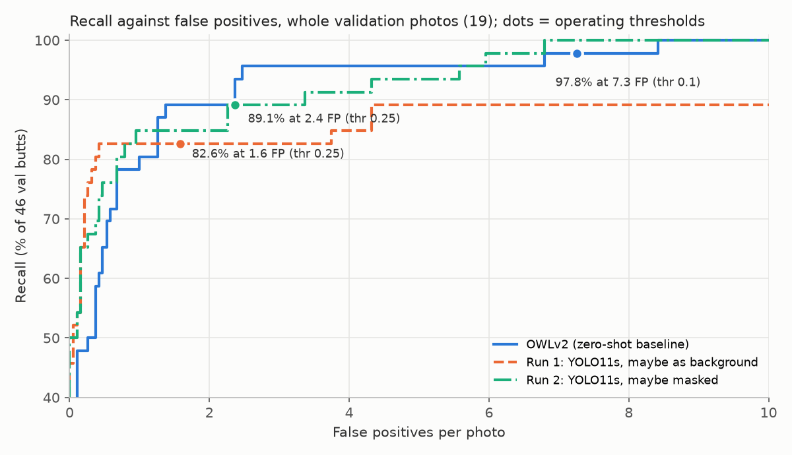

# Trained detectors against the OWLv2 baseline

**Scope label:** YOLO11s and YOLO11n trained on one phone session (Valencia, Spain, 2026-10-01), scored on 19 validation photos from the same session; one seed per run.

## Where the project stands

The zero-shot baseline and the two current trained models on the same 19 validation photos (46 butts, labelled blind), scored by the same harness on the same labels (identical label hash in all three results). The trained models are the fold 0 models of the cross-validation (`cross-validation.md`): they trained on the 87 train photos and never saw these 19. One session, one seed per model, no intervals on the curves. Chart: `pipeline/progress_plot.py`; data: `eval/owlv2_val.json`, `runs/04-cv-hard-negatives_f0/04-cv-hard-negatives_f0_val.json`, `runs/06-cv-yolo11n_f0/06-cv-yolo11n_f0_val.json`.

**At each model's operating threshold** (95% intervals: Wilson for recall, a bootstrap over whole photos for false positives):

| | Threshold | Recall | False positives per photo |
|---|---|---|---|
| OWLv2, zero-shot | 0.10 | 97.8% (88.7–99.6%), 45 of 46 | 7.3 (4.7–10.7) |
| YOLO11s, `04-cv-hard-negatives` fold 0 | 0.25 | 82.6% (69.3–90.9%), 38 of 46 | 0.84 (0.47–1.32) |
| YOLO11n, `06-cv-yolo11n` fold 0 | 0.25 | 78.3% (64.4–87.7%), 36 of 46 | 0.74 (0.37–1.16) |

**At matched recall** (false positives per photo at the highest threshold whose recall reaches the level, read from each model's curve):

| Recall at least | OWLv2 | YOLO11s (04, fold 0) | YOLO11n (06, fold 0) |
|---|---|---|---|
| 70% | 0.58 | 0.05 | 0.00 |
| 80% | 1.00 | 0.42 | 0.95 |
| 85% | 1.26 | 1.89 | 2.68 |
| 89% | 1.37 | 2.00 | not reached |
| 97.8% | 6.79 | not reached | not reached |
| Highest recall reached | 100% | 89.1% | 87.0% |

The trained models' highest recall is at the lowest threshold kept (0.01); OWLv2 reaches 100% at its raw cutoff (0.05).

**Speed and size** (harness time per photo on this PC's CPU, i5-1145G7, mean over the 19 photos; `speed` and `compute` in each result):

| | Parameters | Compute per photo | CPU per photo | Kaggle T4, detection per 640 px tile |
|---|---|---|---|---|
| OWLv2 | 155 M | 11,488 GFLOPs (18 tiles) | 119 s | not measured |
| YOLO11s (04, fold 0) | 9.4 M | 1,071 GFLOPs (50 tiles) | 6.5 s | 10.7 ms |
| YOLO11n (06, fold 0) | 2.6 M | 322 GFLOPs (50 tiles) | 2.1 s | 9.2 ms |

The T4 figures are Ultralytics' end-of-training timing (`runs/<run>/kaggle/train.log`), taken on small validation batches; across the five 06 runs they range 8.0–14.5 ms, so they do not separate the two model sizes.

**Reading:**

- **At strict settings (70–80% recall) both trained models match or beat OWLv2:** at 80% recall YOLO11s has 0.42 false positives per photo against OWLv2's 1.00, and YOLO11n 0.95.
- **From about 85% recall up, OWLv2 is more precise, and the trained models cannot reach its high-recall range.** At 85% OWLv2 has 1.26 false positives per photo against 1.89 (YOLO11s) and 2.68 (YOLO11n); YOLO11s stops at 89.1% recall and YOLO11n at 87.0%, while OWLv2 goes on to 97.8% at 6.79 false positives per photo.
- **YOLO11n trades the high-recall end for speed:** about 3 times faster than YOLO11s on this CPU for these two models (2.5–3 times across all cross-validation runs, `cross-validation.md`) and about 58 times faster than OWLv2 (YOLO11s: about 18 times).
- **Every gap here rests on a few butts.** One butt is about 2 points of recall, the operating-point intervals overlap between the two trained models, and the pooled cross-validation over 106 photos finds no difference between 04 and 06 at 80%, 85% or 88% recall that clears noise (`cross-validation.md`). The comparison with OWLv2 exists only on these 19 photos, because folds 1–4 carry labels made with OWLv2's proposals on screen.
- **The comparison flatters the trained models** for the reason given under runs 01 and 02 below: the validation photos come from the same walk as the training photos.

## Runs 01 and 02: the first trained detectors

### Question

1. How does a small detector trained on this dataset compare with OWLv2, the zero-shot detector used as the frozen baseline, on whole photos: recall, false positives per photo, speed?
2. Does it matter how uncertain (`maybe`) boxes are treated in training? One train object in five is a `maybe` (53 of 266 boxes).

### Setup

| | `01-maybe-as-background` | `02-maybe-masked` |
|---|---|---|
| Model | YOLO11s, COCO-pretrained weights, Ultralytics 8.4.184 | same |
| `maybe` boxes in training tiles | background (unlabelled) | masked (painted flat grey) |
| Everything else | identical | identical |

- **Training data:** 87 train photos cut into 640 px square tiles at native resolution, 384 px spacing. A box is a target in a tile when at least 80% of it is inside. Train holds every tile with a target (419) plus empty tiles making up 10% of train (47): 466 tiles, 510 targets.
- **Training:** Ultralytics' defaults, including its augmentation (mosaic, zoom 0.5–1.5×, translation, horizontal mirror, colour), 100 epochs, tiles cached on disk. Both runs trained at the same time on Kaggle's T4 machine, one GPU each, from one kernel.
- **Scoring:** the shared evaluation harness (`pipeline/evaluate.py`) on the 19 validation photos (46 butts, labelled blind, without detector suggestions). Each photo is tiled on the same 640 px grid, detections are mapped back to the full photo and merged (NMS at IoU 0.3). A butt is found when a detection's centre falls inside its box or the two overlap by at least 30%. `maybe` boxes count neither way. Operating threshold 0.25 for both runs (OWLv2: 0.10).
- **Records:** each run's full config, commits, label hash, training output and harness result sit in its run directory (`runs/01-maybe-as-background/`, `runs/02-maybe-masked/` in the project repository).

### Results

**At each model's operating threshold** (95% intervals: Wilson for recall, a bootstrap over whole photos for false positives, approximate at 19 photos):

| | Threshold | Recall | False positives per photo | Boxes per photo | Precision |
|---|---|---|---|---|---|
| OWLv2 (baseline) | 0.10 | 97.8% (88.7–99.6%) | 7.3 (4.7–10.7) | 10.3 | 0.27 |
| 01 maybe as background | 0.25 | 82.6% (69.3–90.9%) | 1.6 (1.0–2.2) | 3.8 | 0.58 |
| 02 maybe masked | 0.25 | 89.1% (77.0–95.3%) | 2.4 (1.6–3.3) | 5.0 | 0.51 |

**At matched recall** (false positives per photo at the highest threshold reaching the recall, from each model's curve):

| Recall at least | OWLv2 | Run 01 | Run 02 |
|---|---|---|---|
| 80% | 1.0 | 0.4 | 0.7 |
| 85% | 1.3 | 4.3 | 2.3 |
| 89% | 1.4 | 4.3 | 2.3 |
| 91% | 2.4 | not reached | 3.4 |
| 95.7% | 2.5 | not reached | 5.6 |
| 97.8% | 6.8 | not reached | 6.0 |

Run 01 never exceeds 89.1% recall, even at the lowest threshold kept (0.01). Run 02 and OWLv2 both reach 100%.

**Recall by butt size** (box long side, native px; at the operating thresholds):

| Size | Butts | OWLv2 | Run 01 | Run 02 |
|---|---|---|---|---|
| 30–45 px | 5 | 5 | 3 | 4 |
| 45–60 px | 9 | 8 | 7 | 8 |
| 60–90 px | 13 | 13 | 11 | 12 |
| 90–120 px | 8 | 8 | 8 | 8 |
| 120 px and up | 11 | 11 | 9 | 9 |

**By shot type** (recall, false positives per photo):

| Shot type | Photos | Butts | OWLv2 | Run 01 | Run 02 |
|---|---|---|---|---|---|
| Wide | 14 | 32 | 97% (31), 5.2 | 84% (27), 1.5 | 97% (31), 2.1 |
| Close-up | 3 | 8 | 100% (8), 13.0 | 75% (6), 1.7 | 63% (5), 3.7 |
| High | 2 | 6 | 100% (6), 13.0 | 83% (5), 2.0 | 83% (5), 2.0 |

**Speed and size:**

| | Parameters | Compute per photo | This PC's CPU (i5-1145G7), per photo | Kaggle T4, per 640 px tile |
|---|---|---|---|---|
| OWLv2 | 155 M | 11,488 GFLOPs | 119 s | not measured |
| YOLO11s (01 / 02) | 9.4 M | 1,071 GFLOPs (50 tiles) | 4.7 s / 5.2 s | 11.1 / 13.3 ms detection, 12–15 ms with preparation and box clean-up |

The T4 figures are Ultralytics' own timing during its final validation (batched tiles, reduced numerical precision), not the harness. × 50 tiles gives about 0.6–0.7 s per photo, an inference.

**Training:** 100 epochs took 24 min (01) and 22 min (02), about 13–14 s per epoch with the two runs sharing the machine's four CPU cores.

### Reading

- **Speed:** the trained model is about 23–25 times faster than OWLv2 on the same CPU, from about 11 times less compute. On a T4 it needs about 0.6–0.7 s per photo.
- **Accuracy is in OWLv2's range, not clearly better or worse.** The trained models produce fewer false positives at low recall (below about 85%), OWLv2 produces fewer between about 85% and 96%, and run 02 is slightly ahead again at OWLv2's own recall (97.8%). The fixed-threshold numbers alone (1.6–2.4 against 7.3 false positives) overstate the trained models, because their thresholds sit at a lower recall.
- **`maybe` handling: inconclusive.** Run 02 (masked) is ahead on recall at the same threshold (89.1% against 82.6%) and is the only trained run that reaches high recall at all, but the operating-point intervals overlap, and each run has one seed, so training noise is not separated from the setting. Masking is the better-supported setting on this evidence, not a proven one.
- **Where the trained models miss:** both miss 2 of the 11 largest butts (120 px and up) that OWLv2 finds, and close-ups are their weakest shot type (5–6 of 8). With 3 close-up photos, this is a pattern to check, not a finding; one candidate cause is that close-ups are few in train, another that large butts are cut by more tile borders. Neither has been tested.
- **The comparison flatters the trained models.** Validation photos come from the same 22-minute walk as the training photos (same streets, light and phone), while OWLv2 was never fitted to this session. Equal scores here do not show equal accuracy on new streets.

## Known gaps

- 19 validation photos and 46 butts: one butt is about 2 points of recall, and most differences above are inside the intervals.
- One seed per run; the run-to-run spread of training is not measured.
- Validation shares the session with training; no held-out session exists yet.
- No validation butt is under 30 px, so these results say nothing about the trained model's size floor; the downscale test has not been repeated on it.
- The test split has not been scored; it is reserved for the finalist.
- T4 timings come from Ultralytics' batched validation, not from whole-photo scoring, and nothing has been timed on robot hardware.
- The causes of the large-butt and close-up misses are untested.
- The 04 and 06 fold 0 models trained before the label review that added 4 butts and 1 `maybe` to train photos (`error-analysis.md`); the validation labels are unchanged by it.
- CPU times come from one harness pass per model on this PC, with other work running at times; OWLv2's time per photo ranged 75–154 s within its pass (`owlv2-baseline.md`).
